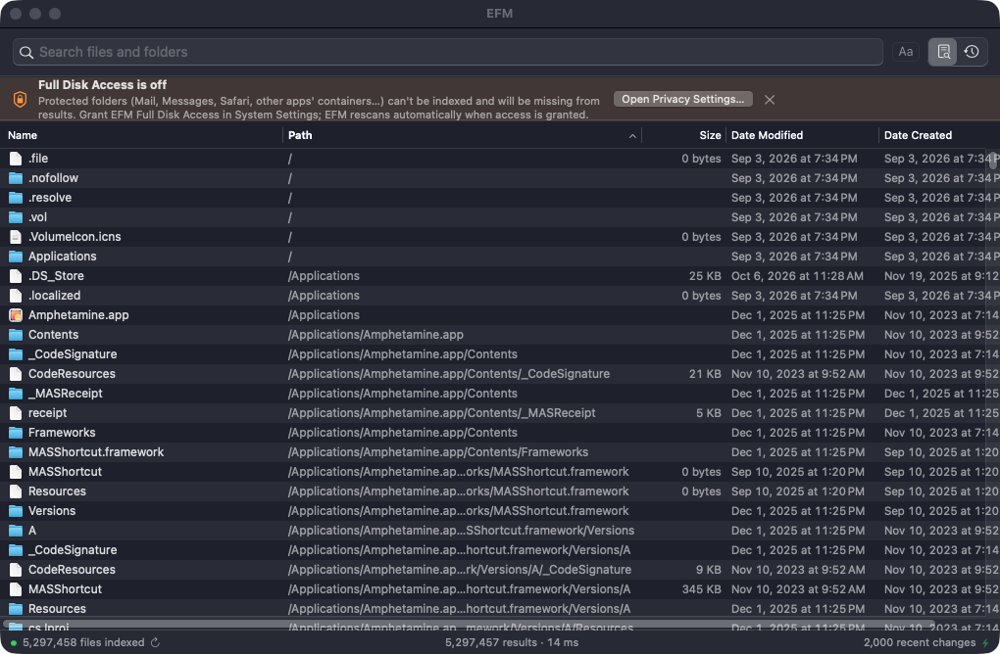

# EFM

macOS용 즉시 파일 이름 검색 앱. Windows의 [Everything](https://www.voidtools.com/)과 같은 방식(파일 이름만 메모리에 올려 두고 입력할 때마다 전부 훑기)으로 동작하고, 검색 문법과 기능은 [Cardinal](https://github.com/cardisoft/cardinal)과 맞췄습니다.

- 네이티브 AppKit 앱(웹뷰 없음), 엔진은 Swift + C(NEON SIMD)
- 홈 폴더 379만 항목 기준 검색 2~6ms, 최초 색인 21초 (Cardinal 엔진 대비 질의별 7~170배, [벤치마크](docs/BENCHMARK.md))
- Everything / Cardinal 검색 문법: `report draft`, `*.pdf`, `ext:png;jpg`, `size:>1gb`, `dm:today`, `in:~/Projects`, `src/**/main.rs`, `regex:`, `content:`, `tag:` 등 ([전체 문법](docs/reference/cardinal-search-syntax.md))
- FSEvents로 실시간 반영, 종료 후 다시 켜면 저장된 색인을 불러오고 그 사이 변경분만 재생
- 한글 파일 이름: NFC/NFD 어느 쪽으로 저장돼 있어도 한 번에 검색



## 빌드와 실행

Xcode 27(Swift 6.4), macOS 14 이상이 필요합니다.

```bash
scripts/build-app.sh
```

```bash
open build/EFM.app
```

처음 실행하면 시스템 설정 > 개인정보 보호 및 보안 > **전체 디스크 접근 권한**에서 EFM을 허용해야 보호된 폴더(메일, 메시지 등)까지 색인됩니다. 개발용 빌드는 임시 서명(ad-hoc)이라 다시 빌드하면 권한을 다시 허용해야 할 수 있습니다.

단축키: ⌘⇧Space 창 열기/닫기, Space 미리보기(Quick Look), Enter 열기, ⌘R Finder에서 보기, ⌘C 파일 복사, ⇧⌘C 경로 복사, Esc 숨기기.

## 명령줄 도구

```bash
swift build -c release --product efm
```

```bash
.build/release/efm search --root ~ "report" "ext:swift" "size:>100mb"
```

`efm bench`는 같은 질의를 반복 실행해 시간만 출력합니다. Cardinal과의 비교는 `tools/bench/run.sh`로 재현할 수 있습니다.

## 테스트

```bash
swift test
```

## 구조

| 모듈 | 역할 |
|---|---|
| `Sources/EFMQuery` | 검색 문법 파서, 경로 패턴, 크기·날짜·종류 조건 |
| `Sources/EFMCore` | 이름 풀, 파일 트리 색인, 스캐너(`getattrlistbulk`), FSEvents 반영, 검색 엔진, 정렬, 저장/로드 |
| `Sources/CEFM` | C: 디렉터리 일괄 읽기, NEON 부분 문자열 검색 |
| `Sources/EFMApp` | AppKit 앱 |
| `Sources/efm` | 명령줄 도구 |

설계와 분석 문서:
- [설계안](docs/DESIGN.md)
- [Everything 바이너리 REA 분석](docs/analysis/REA-FINDINGS.md)
- [Cardinal 대비 벤치마크](docs/BENCHMARK.md)

## 출처

- 검색 문법, 질의 파서 일부, 종류(type:) 분류는 Cardinal(MIT, Copyright (c) 2025 Cardinal Contributors)에서 가져왔습니다. 해당 파일에 출처를 표시했습니다.
- Everything의 내부 구조는 REA와 Ghidra로 분석해 설계에 참고했고, 코드는 가져오지 않았습니다.
